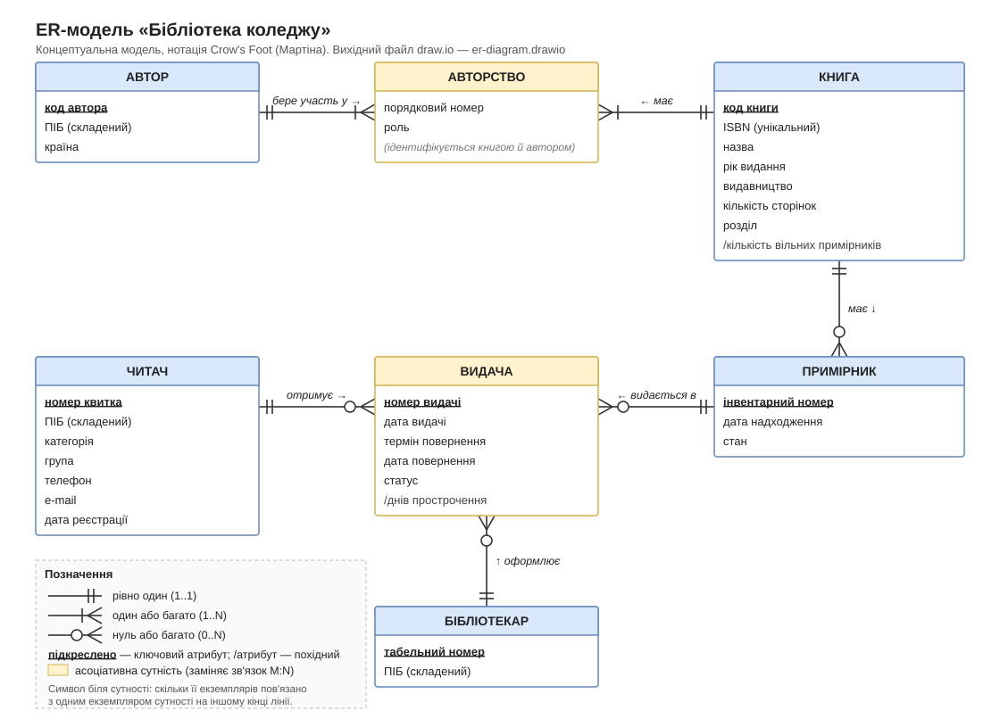

# Практична робота №2. Побудова ER-моделі предметної області

**Дисципліна:** Бази даних
**Виконав:** Гриценко Максим, група ІПЗ-41
**Дата:** 16.11.2026

## Мета

Навчитися виділяти сутності, атрибути та зв'язки з текстового опису вимог і будувати концептуальну ER-модель.

**Файли роботи:**

- [`er-diagram.drawio`](er-diagram.drawio) — вихідний файл ER-діаграми (відкривається в [draw.io](https://app.diagrams.net): *Файл → Відкрити з → Пристрій*);
- [`er-diagram.svg`](er-diagram.svg) — ER-діаграма у форматі SVG.

---

## 1. Предметна область

Предметна область з практичної роботи №1 — **бібліотека коледжу** (облік книжкового фонду та видачі книг).

### Опис вимог

> Бібліотекар додає до каталогу книги. Кожна книга має код, ISBN, назву, рік видання, видавництво, кількість сторінок і розділ. Книгу написав один або кілька авторів, а один автор може написати багато книг. Для кожної книги важливо зберігати порядок авторів на обкладинці та роль кожного (автор, укладач, редактор). Про автора зберігають ПІБ і країну.
>
> Бібліотека отримує кілька примірників однієї книги. Кожен примірник має інвентарний номер, дату надходження і стан.
>
> Бібліотекар реєструє читачів — студентів і викладачів. Про читача зберігають номер читацького квитка, ПІБ, категорію, групу, телефон, e-mail і дату реєстрації.
>
> Бібліотекар оформлює видачу примірника читачу. У видачі фіксують дату видачі, термін повернення, дату фактичного повернення і статус. Читач повертає примірник, і бібліотекар відмічає повернення. Система показує, на скільки днів прострочено повернення, і скільки вільних примірників має книга.

---

## 2. Іменники та дієслова з опису вимог

### Іменники

| Іменник | Рішення | Пояснення |
|---|---|---|
| бібліотека | — (межа системи) | у системі лише одна бібліотека, окремих фактів про неї не зберігаємо |
| каталог | — | це множина книг, а не окремий об'єкт |
| **книга** | **сутність** | багато екземплярів, власні властивості та зв'язки |
| код, ISBN, назва, рік видання, видавництво, кількість сторінок, розділ | атрибути книги | описують одну властивість книги |
| **автор** | **сутність** | один автор пише багато книг, ПІБ не гарантує унікальності |
| ПІБ, країна | атрибути автора | |
| порядок авторів, роль | атрибути зв'язку «книга — автор» | належать не книзі й не автору окремо, а їх поєднанню |
| **примірник** | **сутність** | у кожного свій інвентарний номер, стан, історія видач |
| інвентарний номер, дата надходження, стан | атрибути примірника | |
| **читач** | **сутність** | |
| студент, викладач | значення атрибута «категорія» | окремих фактів, які відрізняли б їх, вимоги не містять |
| номер квитка, ПІБ, група, телефон, e-mail, дата реєстрації | атрибути читача | |
| **бібліотекар** | **сутність** | треба знати, хто оформив видачу |
| **видача** | **сутність** (подія) | має власні атрибути: дати, статус |
| дата видачі, термін повернення, дата повернення, статус | атрибути видачі | |
| кількість вільних примірників, днів прострочення | похідні атрибути | обчислюються з інших даних |
| видавництво | атрибут (не сутність) | вимоги не потребують окремих фактів про видавництво |

### Дієслова

| Дієслово | Рішення | Пояснення |
|---|---|---|
| додає (книгу) | операція | хто додав книгу, не зберігаємо |
| **написав** (автор — книгу) | **зв'язок** АВТОР — КНИГА (M:N) | |
| **отримує** (примірники книги) | **зв'язок** КНИГА — ПРИМІРНИК | бібліотека не сутність, тому зв'язок між книгою та її примірниками |
| реєструє (читачів) | операція | хто зареєстрував, не зберігаємо |
| **оформлює** (видачу) | **зв'язок** БІБЛІОТЕКАР — ВИДАЧА | |
| **видає** (примірник читачу) | **зв'язки** ЧИТАЧ — ВИДАЧА, ПРИМІРНИК — ВИДАЧА | |
| повертає / відмічає повернення | операція | змінює атрибути видачі (дата повернення, статус), окремий зв'язок не потрібен |
| показує | операція | обчислює похідні значення |

---

## 3. Сутності та словник даних

Обрано **7 сутностей**: КНИГА, АВТОР, АВТОРСТВО, ПРИМІРНИК, ЧИТАЧ, БІБЛІОТЕКАР, ВИДАЧА.
АВТОРСТВО та ВИДАЧА — асоціативні сутності (див. п. 5).

Позначення: **К** — кандидатний ключ, обраний для ідентифікації; *ПІБ* — складений атрибут (прізвище, ім'я, по батькові); `/` — похідний атрибут (обчислюється, а не вводиться).

### КНИГА — опис видання в каталозі

| Атрибут | Домен / тип | Ключ | Обов'язковий | Вид |
|---|---|---|---|---|
| код книги | рядок, формат `К-00000` | **К** | так | простий |
| ISBN | рядок з 13 цифр | унікальний | ні | простий |
| назва | рядок до 200 символів | | так | простий |
| рік видання | ціле число 1900…поточний рік | | так | простий |
| видавництво | рядок до 100 символів | | ні | простий |
| кількість сторінок | ціле число > 0 | | ні | простий |
| розділ | перелік: інформатика, математика, фізика, художня література, … | | так | простий |
| /кількість вільних примірників | ціле число ≥ 0 | | — | похідний |

Кандидатні ключі: *код книги*, а також ISBN, але ISBN є не в усіх старих виданнях (не обов'язковий). Тому основним ключем обрано код книги.

### АВТОР

| Атрибут | Домен / тип | Ключ | Обов'язковий | Вид |
|---|---|---|---|---|
| код автора | рядок, формат `А-0000` | **К** | так | простий |
| ПІБ | прізвище, ім'я, по батькові — рядки до 50 символів | | так | складений |
| країна | рядок до 50 символів | | ні | простий |

ПІБ не є ключем, бо можуть бути однофамільці, тому введено код автора.

### АВТОРСТВО — участь автора у створенні книги

| Атрибут | Домен / тип | Ключ | Обов'язковий | Вид |
|---|---|---|---|---|
| (книга + автор) | — | **К** (складений) | так | ідентифікується зв'язками |
| порядковий номер | ціле число 1…20 | | так | простий |
| роль | перелік: автор, укладач, редактор | | так | простий |

### ПРИМІРНИК — фізична книжка на полиці

| Атрибут | Домен / тип | Ключ | Обов'язковий | Вид |
|---|---|---|---|---|
| інвентарний номер | рядок, формат `INV-00000` | **К** | так | простий |
| дата надходження | дата | | так | простий |
| стан | перелік: новий, добрий, зношений, списаний | | так | простий |

### ЧИТАЧ

| Атрибут | Домен / тип | Ключ | Обов'язковий | Вид |
|---|---|---|---|---|
| номер квитка | рядок, формат `ЧК-0000` | **К** | так | простий |
| ПІБ | прізвище, ім'я, по батькові | | так | складений |
| категорія | перелік: студент, викладач | | так | простий |
| група | рядок до 10 символів, наприклад `ІПЗ-41` | | лише для студента | простий |
| телефон | рядок, формат `+380XXXXXXXXX` | | так | простий |
| e-mail | рядок з символом `@` | | ні | простий |
| дата реєстрації | дата | | так | простий |

E-mail теж міг би бути ключем, але він не обов'язковий і може змінитися, тому ключем обрано номер квитка.

### БІБЛІОТЕКАР

| Атрибут | Домен / тип | Ключ | Обов'язковий | Вид |
|---|---|---|---|---|
| табельний номер | рядок, формат `Т-000` | **К** | так | простий |
| ПІБ | прізвище, ім'я, по батькові | | так | складений |

### ВИДАЧА — факт видачі примірника читачу

| Атрибут | Домен / тип | Ключ | Обов'язковий | Вид |
|---|---|---|---|---|
| номер видачі | ціле число > 0 | **К** | так | простий |
| дата видачі | дата | | так | простий |
| термін повернення | дата ≥ дата видачі | | так | простий |
| дата повернення | дата ≥ дата видачі | | ні (порожня, поки не повернули) | простий |
| статус | перелік: видано, повернено, втрачено | | так | простий |
| /днів прострочення | ціле число ≥ 0 | | — | похідний |

---

## 4. Зв'язки між сутностями

Усі зв'язки **бінарні** (ступінь 2). У стовпці «Участь» вказано, скільки екземплярів *іншої* сутності може мати один екземпляр цієї сутності (мінімум..максимум).

| № | Зв'язок (читається в обох напрямках) | Тип | Участь першої сутності | Участь другої сутності |
|---|---|---|---|---|
| З1 | АВТОР бере участь в АВТОРСТВІ / АВТОРСТВО стосується АВТОРА | 1:N | автор: **1..N** авторств — обов'язкова (автора вносять лише разом із його книгою) | авторство: **1..1** автор — обов'язкова |
| З2 | КНИГА має АВТОРСТВО / АВТОРСТВО стосується КНИГИ | 1:N | книга: **1..N** авторств — обов'язкова (у книги є щонайменше один автор або укладач) | авторство: **1..1** книга — обов'язкова |
| З3 | КНИГА має ПРИМІРНИК / ПРИМІРНИК належить КНИЗІ | 1:N | книга: **0..N** примірників — необов'язкова (книгу можна внести в каталог до надходження) | примірник: **1..1** книга — обов'язкова |
| З4 | ЧИТАЧ отримує ВИДАЧУ / ВИДАЧА оформлена на ЧИТАЧА | 1:N | читач: **0..N** видач — необов'язкова (новий читач ще нічого не брав) | видача: **1..1** читач — обов'язкова |
| З5 | ПРИМІРНИК видається у ВИДАЧІ / ВИДАЧА стосується ПРИМІРНИКА | 1:N | примірник: **0..N** видач — необов'язкова (новий примірник ще не видавали) | видача: **1..1** примірник — обов'язкова |
| З6 | БІБЛІОТЕКАР оформлює ВИДАЧУ / ВИДАЧА оформлена БІБЛІОТЕКАРЕМ | 1:N | бібліотекар: **0..N** видач — необов'язкова (новий працівник) | видача: **1..1** бібліотекар — обов'язкова |

Додаткове правило, яке діаграма не показує: **один примірник не може бути одночасно у двох видачах зі статусом «видано»**. Кардинальність 0..N описує всю історію видач примірника, а це обмеження стосується лише поточного стану. Його реалізують пізніше, на рівні СКБД або застосунку.

---

## 5. Зв'язки типу M:N і проміжні сутності

У моделі є два зв'язки «багато до багатьох»:

| Зв'язок M:N | Чому M:N | Проміжна сутність | Її власні атрибути |
|---|---|---|---|
| КНИГА — АВТОР | у книги може бути кілька авторів, автор пише багато книг | **АВТОРСТВО** | порядковий номер, роль |
| ЧИТАЧ — ПРИМІРНИК | читач за весь час бере багато примірників, один примірник видають багатьом читачам | **ВИДАЧА** | дата видачі, термін, дата повернення, статус |

Кожен зв'язок M:N замінено на проміжну (асоціативну) сутність і два зв'язки 1:N.

### Пояснення зв'язку M:N «ЧИТАЧ — ПРИМІРНИК»

Один читач протягом навчання бере багато різних примірників, а один примірник за роки видають багатьом читачам, тому зв'язок між ними — «багато до багатьох». Проте дата видачі, термін повернення, дата повернення і статус не належать ні читачу, ні примірнику окремо. Вони описують конкретний факт: *цей* читач взяв *цей* примірник *у цей день*. Тому цю подію виділено в окрему сутність **ВИДАЧА**. Кожна видача пов'язана рівно з одним читачем і рівно з одним примірником (1..1), а читач і примірник можуть мати від нуля до багатьох видач (0..N). Так M:N перетворився на два зв'язки 1:N, і в кожної видачі є власний ключ (номер видачі). Це дозволяє зберігати навіть кілька видач того самого примірника тому самому читачу в різні дні.

---

## 6. ER-діаграма

Нотація — **Crow's Foot (Мартіна)**, засіб — **draw.io**. Вихідний файл: [`er-diagram.drawio`](er-diagram.drawio).

Як читати символи: символ біля сутності показує, скільки її екземплярів пов'язано з одним екземпляром сутності на іншому кінці лінії. Наприклад, на лінії ЧИТАЧ — ВИДАЧА біля ВИДАЧІ стоїть «коло + лапка» (0..N): один читач має від 0 до багатьох видач. Біля ЧИТАЧА стоять «дві риски» (1..1): кожна видача належить рівно одному читачу.

---

## 7. Перевірка моделі сценаріями

| Сценарій | Чи дозволяє модель | Чому |
|---|---|---|
| Новий читач ще не брав книг | так | ЧИТАЧ має 0..N видач |
| Книгу внесли в каталог, примірники ще не надійшли | так | КНИГА має 0..N примірників |
| Додати книгу без жодного автора | ні | КНИГА має 1..N авторств. Для збірників автором вважається укладач |
| Видача без читача або без примірника | ні | ВИДАЧА має 1..1 читача й 1..1 примірник |
| Один примірник за рік видавали 10 разам різним читачам | так | ПРИМІРНИК має 0..N видач |
| Книгу повернули | так | у ВИДАЧІ заповнюється дата повернення, статус — «повернено» |
| Списаний примірник лишається в історії видач | так | примірник не видаляється, змінюється атрибут «стан» |

### Припущення, які треба уточнити в бібліотеки

1. Чи потрібно зберігати бронювання книг (читач замовив, але ще не забрав)? Якщо так, знадобиться окрема сутність БРОНЮВАННЯ.
2. Чи бувають книги зовсім без автора (наприклад, довідники)? Зараз модель вимагає хоча б одного автора або укладача.
3. Чи можна продовжити термін видачі? Якщо потрібна історія продовжень, вона може стати окремою сутністю.

---

## Відповіді на питання для захисту

**1. Як відрізнити атрибут від сутності?**
Сутність — це об'єкт, про який зберігають *кілька* фактів, у якого багато екземплярів і власні зв'язки з іншими об'єктами (книга, читач, видача). Атрибут — це одна властивість, що описує сутність, і сам по собі він не має власних властивостей (назва, рік видання). Наприклад, «видавництво» в нашій моделі — атрибут книги. Але якби бібліотека зберігала адресу видавництва, контакти й договори з ним, воно стало б окремою сутністю.

**2. Що означає кардинальність 0..N?**
Мінімум 0 — участь у зв'язку необов'язкова: екземпляр може взагалі не мати пов'язаних записів. Максимум N — пов'язаних записів може бути багато. Наприклад, ЧИТАЧ має 0..N видач: щойно зареєстрований читач не має жодної видачі, а з часом їх може бути багато.

**3. Чому зв'язок M:N потребує окремого рішення?**
Зв'язок M:N часто має власні атрибути, які не належать жодній зі сторін: дата видачі не належить ні читачу, ні примірнику, а лише їхній зустрічі. Такі дані нема куди записати, якщо лишити просту лінію між двома сутностями. Крім того, у реляційній моделі зв'язок M:N не можна подати напряму. Тому вводять проміжну (асоціативну) сутність, яка перетворює M:N на два зв'язки 1:N.

**4. Чим нотація Чена відрізняється від Crow's Foot?**

| | Нотація Чена | Crow's Foot |
|---|---|---|
| Сутність | прямокутник | прямокутник зі списком атрибутів усередині |
| Атрибут | овал, з'єднаний із сутністю (ключ підкреслено, багатозначний — подвійний овал, похідний — пунктир) | рядок усередині прямокутника сутності |
| Зв'язок | ромб із назвою | лінія з підписом |
| Кардинальність | цифри 1, N, M біля ліній | символи на кінцях лінії: O — нуль, \| — один, «куряча лапка» — багато |
| Обов'язковість | подвійна лінія | мінімум на кінці лінії: O або \| |
| Де зручна | навчання, ранній аналіз | компактні робочі діаграми в CASE-засобах |
